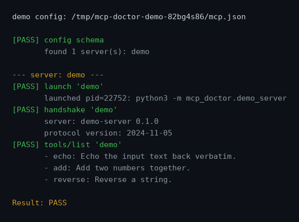

# mcp-doctor

[](https://www.python.org/)
[](LICENSE)
[](#testing)

**Validate MCP (Model Context Protocol) server setups** — config schema,
launchability, the stdio JSON-RPC handshake, and the tool listing — before
you wire a server into your client and wonder why nothing works.

MCP servers talk [JSON-RPC 2.0 over stdio](https://modelcontextprotocol.io):
the client sends `initialize`, the server answers with its capabilities,
then `tools/list`, `tools/call`, and so on. `mcp-doctor` walks that exact
path against a real spawned process, so "it works" means it actually works.



## Install

Zero dependencies. Python 3.9 or newer.

```bash
git clone https://github.com/HimanshuSingh0495/mcp-doctor.git
cd mcp-doctor
pip install -e .
```

## Quickstart

Point it at any MCP config file:

```bash
mcp-doctor check mcp.json
```

Try it with no setup at all — `demo` spins up the bundled demo server,
writes a temp `mcp.json` pointing at it, and runs the full check:

```bash
mcp-doctor demo
```

An `mcp.json` looks like this:

```json
{
  "mcpServers": {
    "filesystem": {
      "command": "npx",
      "args": ["-y", "@modelcontextprotocol/server-filesystem", "/tmp"],
      "env": { "DEBUG": "1" }
    }
  }
}
```

## The checks, in order

For every server in `mcpServers`, `mcp-doctor` runs these and prints
`PASS`/`FAIL` per check, exiting nonzero on the first failure:

1. **Config schema** — the file parses as JSON and matches the expected
   shape: `mcpServers` is a map; each entry has `command` (string),
   optional `args` (list of strings), optional `env` (map of string to
   string). Unknown fields are reported as warnings, not failures.
2. **Launch** — the command exists (on `PATH` or absolute) and the process
   starts without dying immediately. `FileNotFoundError` and instant
   non-zero exits are caught and reported with the stderr snippet.
3. **Handshake** — sends the JSON-RPC `initialize` request over stdio and
   verifies the response carries `result.serverInfo`. Every read has a
   timeout, so a hung server fails the check instead of hanging the CLI.
4. **tools/list** — sends `notifications/initialized`, then `tools/list`,
   and prints each tool's name and description.

## Project layout

```
mcp_doctor/
  cli.py          # entry point: mcp-doctor check | demo
  schema.py       # mcp.json config validation
  proc.py         # subprocess launch + timeout-guarded stdio JSON-RPC I/O
  checks.py       # the four checks
  demo_server.py  # bundled demo MCP server (also: python -m mcp_doctor.demo_server)
tests/            # pytest suite
scripts/capture_screenshot.py  # regenerates docs/demo.png from a real run
docs/demo.png     # real output of `mcp-doctor demo`, rendered as PNG
```

## Testing

```bash
python -m venv .venv
.venv/bin/pip install -e . pytest
.venv/bin/pytest
```

The suite covers schema validation (good config, missing `command`,
wrong types, unknown-field warnings), a real stdio round-trip against the
demo server subprocess, `tools/list` returning the fake tools, clean
failure on a bogus command, a timeout-failing silent server, and the
`demo` command end to end.

The screenshot above is generated from an actual run by
`scripts/capture_screenshot.py` — it asserts the output contains `PASS`
lines and that the PNG has non-background pixels before writing.

## License

MIT — see [LICENSE](LICENSE).
